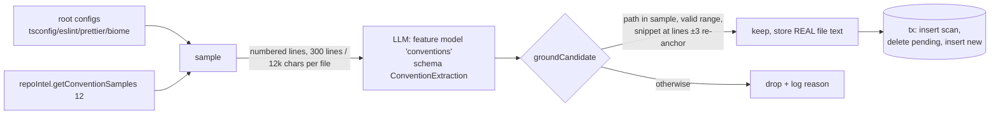

# conventions module

Extracts a repo's **house conventions** with a cheap LLM. Every candidate must cite real code: a file and a line range. The user accepts, rejects or edits candidates, and the accepted ones merge into one `convention` skill (`source: 'extracted'`). Linking that skill to agents is a separate step in the agents module.

## API

| Method | Path | What |
|---|---|---|
| GET | `/repos/:id/conventions` | `{ scan, candidates }`: latest scan meta plus all candidates (confidence desc) |
| POST | `/repos/:id/conventions/extract` | Runs one scan synchronously and returns the list. Rate limit: 10/min |
| PATCH | `/conventions/:id` | `{status?, rule?, category?}`: accept, reject, back to pending, or edit |
| PATCH | `/repos/:id/conventions` | `{ids, status}`: bulk status change ("Deselect all") |
| GET | `/repos/:id/conventions/skill-draft` | Accepted candidates merged into a `ConventionSkillDraft`. 409 if none are accepted |
| POST | `/repos/:id/conventions/skill` | Saves the edited draft as a skill (v1, `evidence_files` = accepted paths) |

Errors: `repo_not_indexed` / `repo_not_cloned` (409), `no_accepted_conventions` (409), `external_service_error` (502, LLM/provider failure).

## Extraction pipeline

- **Sampling is pure code.** It uses repo-intel rank, so the repo must be indexed first.
- **Model choice.** Workspace override (Settings → Feature Models), else the registry default `openai/gpt-4.1-mini`.
- **Re-scan.** Replaces only `pending` candidates. Accepted and rejected ones survive, and a re-detected rule whose normalized text matches a decided one is skipped (`ruleKey`).
- **Path safety.** `safeRelativePath` rejects absolute paths and `..`. The git adapter's `readFile` has no traversal guard.

## Files

- `routes.ts`: Fastify plugin (Zod params and bodies).
- `service.ts`: orchestration (sample → LLM → ground → persist; merge; create skill).
- `helpers.ts`: pure functions: `renderPromptFile`, `groundCandidate`, `buildSkillDraft`, DTO mappers.
- `prompt.ts`: structured-output schema and system prompt.
- `repository/conventions.repo.ts`: owns `conventions` and `convention_scans`.

Tests: `server/test/conventions-helpers.test.ts` (hermetic), `server/test/conventions.it.test.ts` (Testcontainers).
